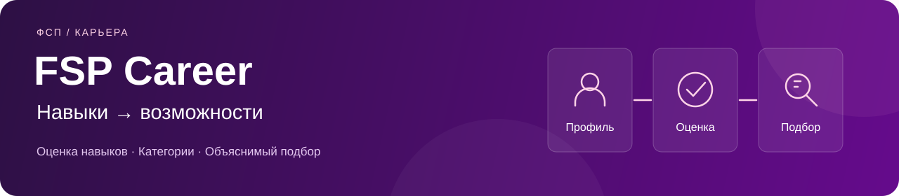

# FSP Career



<div align="center">

[](https://github.com/06ED/fsp-career/actions/workflows/deploy.yml)
[](LICENSE)

[Открыть демо](https://brokenbrain.online) ·
[Техническая документация PDF](docs/FSP-Career-documentation.pdf) ·
[Скринкасты](#демонстрация) ·
[Быстрый запуск](#быстрый-запуск)

</div>

**FSP Career — платформа оценки навыков и подбора специалистов под задачи команды.**
Специалист заполняет профиль и подтверждает категорию тестом, а работодатель получает
ранжированную подборку с объяснением совпадений и отправляет предложение с зарплатной вилкой.

## Как это работает

```text
Специалист:  профиль → опрос и тест → подтверждённая категория → предложения
Компания:   потребность команды → объяснимый подбор → приглашение → контакт
```

Категория состоит из специализации и подтверждённого грейда. Самооценка в резюме
не заменяет результат теста. В сценарии приглашений контакты открываются компании
после принятия предложения специалистом.

## Возможности

| Для специалиста | Для работодателя |
| --- | --- |
| Профиль, опыт, стек и контактные данные | Профиль компании и способы связи |
| Импорт PDF в проверяемый черновик и экспорт резюме | Потребность команды: задачи, грейд, стек и отрасль |
| Адаптивный CAT-тест, результат и история попыток | Подборка по потребности и поиск в банке кандидатов |
| Управление публикацией и видимостью разделов | Рейтинг, факторы совпадения и карточка кандидата |
| Приглашения с условиями и зарплатной вилкой | Приглашения и отслеживание их статусов |
| Поиск вакансий и статусы собственных откликов | Публикация вакансий и обработка откликов |
| Задание недели и обратная связь компании | Короткие задания и оценка решений от 1 до 5 |
| Привязка способов входа и импорт достижений | Учёт видимых достижений ФСП в подборе |

Вход доступен по email и паролю; ФСП ID и VK ID подключаются через серверный OAuth/OIDC.
Роль выбирается один раз для аккаунта. Обработка данных, публикация и приватность
разделов управляются отдельно.

## Демонстрация

| Материал | Ссылка |
| --- | --- |
| Работающее приложение | [brokenbrain.online](https://brokenbrain.online) |
| Скринкасты — Яндекс Диск | [Посмотреть записи](https://disk.yandex.ru/d/8Kw-km6dKgXJEQ) |
| Скринкасты — Google Диск | [Посмотреть записи](https://drive.google.com/drive/folders/1nd1SiafMHe-dXMK5UbNHw3jTvEp_fZPU?usp=sharing) |
| Техническая документация | [PDF, 26 страниц](docs/FSP-Career-documentation.pdf) |
| Контракт API | [OpenAPI](https://brokenbrain.online/openapi.yaml) |

При регистрации по email в демо письмо подтверждения попадает в
[Mailpit](https://brokenbrain.online/mail/). Откройте ссылку из письма и нажмите
**«Подтвердить почту»**. Для показа двух ролей используйте отдельные аккаунты
и независимые браузерные сессии.

Текущий адаптер реестра ФСП использует синтетические записи. В локальном окружении
провайдером ФСП ID служит Keycloak; способы подключения описаны в
[руководстве по авторизации](docs/authentication.md).

## Быстрый запуск

Нужны **Docker Engine и Docker Compose v2**. Команды выполняются из корня репозитория:

```sh
cp .env.example .env
# Укажите свои локальные пароли в .env.
docker compose up --build -d
docker compose ps
```

| Сервис | Адрес |
| --- | --- |
| Приложение | <http://localhost:3000> |
| API и проверка процесса | <http://localhost:8080/health> |
| OpenAPI | <http://localhost:8080/openapi.yaml> |
| Keycloak | <http://localhost:8081> |
| Mailpit | <http://localhost:8025> |

После запуска можно зарегистрироваться по email и подтвердить его через локальный Mailpit.
Подключение внешних провайдеров задаётся отдельно в `.env`.

Подробности: [локальная разработка и проверки](docs/development.md).

## Технологии

| Слой | Стек |
| --- | --- |
| Интерфейс | Svelte 5, SvelteKit 2, TypeScript, Vite, Bun 1.4.2 |
| API | Kotlin, JDK 21, Ktor, встроенный DI |
| Данные | PostgreSQL, Exposed DAO/SQL, HikariCP, Flyway |
| Авторизация | Cookie-сессии, OAuth/OIDC с PKCE, Keycloak, VK ID |
| Резюме | PDFBox для импорта, pdfmake для экспорта |
| Доставка | GitHub Actions, Docker, GHCR, Kubernetes, Flux, Kustomize |

API организован как модульный монолит с контекстами `identity`, `profiles`,
`assessment`, `matching`, `recruitment` и `achievements`. В каждом разделены
доменная логика, сценарии приложения, инфраструктура и HTTP-адаптеры.

## Структура репозитория

```text
apps/
  web/                 интерфейс SvelteKit
  api/                 API, бизнес-правила, миграции и OpenAPI
docs/                  руководства и техническая документация
  documentation/       исходник PDF и команда сборки
deploy/homelab/        production-манифесты Kubernetes
infra/
  keycloak/            realm и тема ФСП ID
  deploy/              инструменты GitOps-доставки
.github/workflows/     CI/CD
compose.yaml           полный локальный стек
```

## Документация

| Раздел | Что внутри |
| --- | --- |
| [Навигация по документации](docs/README.md) | Все руководства и основные технические правила |
| [Разработка](docs/development.md) | Docker, запуск компонентов, конфигурация и тесты |
| [Авторизация](docs/authentication.md) | Подтверждение email, ФСП ID, VK ID и привязка аккаунтов |
| [Web](apps/web/README.md) | Маршруты, состояние, структура frontend и API-клиент |
| [API](apps/api/README.md) | Архитектура, доменные модули, контракты и проверки |
| [Развёртывание](docs/homelab.md) | Pipeline, Flux, окружение и откат релизов |
| [Production-манифесты](deploy/homelab/README.md) | Kustomize-наборы и runtime-конфигурация |
| [Техническая документация PDF](docs/FSP-Career-documentation.pdf) | Архитектура, PostgreSQL, алгоритмы, API и эксплуатация |
| [Сборка PDF](docs/documentation/README.md) | Редактируемый Typst-исходник и воспроизводимая сборка |

## Проверки и доставка

CI проверяет Svelte/TypeScript, frontend-тесты, ESLint, production-сборку,
API-тесты с PostgreSQL и GitOps-манифесты. После успешной проверки `main` образы
web, API и Keycloak публикуются в GHCR, их digests обновляются одним коммитом,
а Flux применяет релиз в namespace `fsp-career`.

[Workflow CI/CD](.github/workflows/deploy.yml) ·
[Запуски GitHub Actions](https://github.com/06ED/fsp-career/actions) ·
[Команды локальных проверок](docs/development.md#проверки)

## Лицензия

Код и документация распространяются по [MIT License](LICENSE).
Лицензии используемых шрифтов находятся в [каталоге fonts](apps/web/static/fonts).
