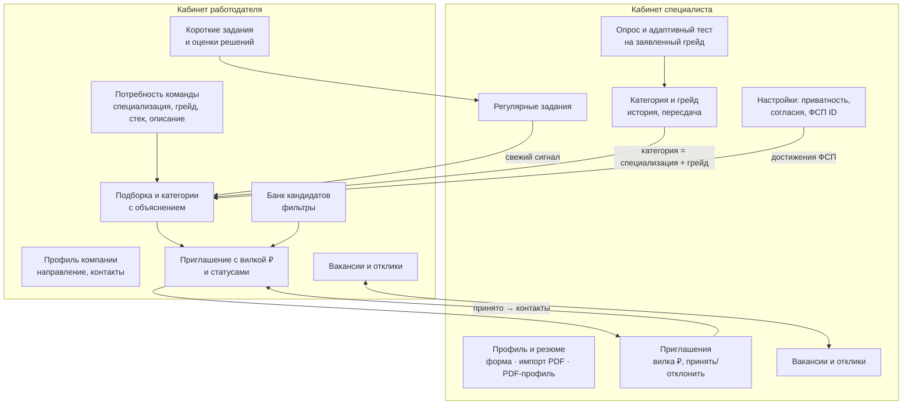
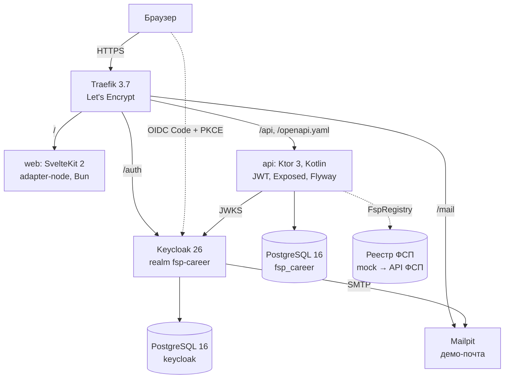

# Архитектура решения {#architecture}

## Функциональная архитектура

**Главный сценарий — обратный подбор.** Специалист не откликается вслепую. Он один раз проходит обязательный путь (опрос → выбор грейда → тест) и получает подтверждённую категорию. Работодатель описывает потребность, получает ранжированную подборку с объяснением и сам отправляет приглашение с описанием и зарплатной вилкой. Контакты специалиста открываются только после того, как он примет приглашение. Классический сценарий (вакансия и отклик) реализован как дополнительный.

## Компонентная архитектура

| Слой | Компонент | Ответственность |
|---|---|---|
| Frontend | `apps/web` (SvelteKit, TypeScript, StyleX) | Лендинг и единое веб-приложение с двумя кабинетами. Вход через keycloak-js, вызовы API с Bearer-токеном. |
| Backend | `apps/api` (Ktor, монолит с модулями) | Вся бизнес-логика и авторизация на сервере, OpenAPI-спецификация. |
| Хранение | PostgreSQL 16 | Реляционная схема под управлением Flyway (миграции `V1…V5`), JSONB для списков (стек, навыки). |
| Идентификация | Keycloak 26 | Регистрация по e-mail с подтверждением, вход и сессии. Подготовлен к подключению ФСП ID как Identity Provider. |
| Инфраструктура | Docker Compose, Traefik, GitHub Actions | Воспроизводимый запуск, HTTPS, автодеплой. |

## Модули API

Монолит разделён на слабо связанные модули. Каждый владеет своими таблицами, моделями и маршрутами и общается с другими через узкие функции хранилища.

| Модуль | Файлы | Что делает |
|---|---|---|
| Аккаунты и роли | `AccountRoutes.kt`, `CareerStore.kt` | `GET /api/me`, одноразовый выбор роли `POST /api/me/role`, проверка роли и владения записями. |
| Профиль и резюме | `CareerRoutes.kt`, `ResumeRoutes.kt`, `PdfExport.kt` | Профиль, согласия, импорт PDF с автораспознаванием в черновик, генерация PDF-профиля. |
| Тестирование | `assessment/*` | Справочники, банк семейств заданий, генераторы, адаптивный тест, правила пересдачи, построение теста по вакансии. |
| Подбор | `matching/*` | Признаки, ранжирование, объяснения, рекомендуемые категории, банк кандидатов. |
| ФСП | `FspRegistry`, `MockFspRegistry` | Привязка ФСП ID, импорт достижений, политика баллов. |
| Приглашения | `CareerRoutes.kt`, `CareerStore.kt` | Приглашения с вилкой ₽ и статусами, раскрытие контактов после принятия. |
| Вакансии и отклики | `Vacancy*.kt` | Публикация, отклики, статусы, раскрытие контактов при отклике. |
| Регулярные задания | `Task*.kt` | Еженедельная ротация заданий, решения, оценки работодателя, сигнал актуальности. |

## Данные

Основные сущности: `accounts` (subject Keycloak → роль); `candidate_profiles` (профиль, согласия, приватность, ФСП ID); `employer_companies` и `employer_needs`; `assessment_attempts` (опрос, заявленный грейд, θ, результат, подтверждённый грейд) и ответы; `achievements` (подтверждённые достижения ФСП); `invitations` (описание, вилка ₽, способ связи, статус); `vacancies`, `vacancy_applications`; `short_tasks`, `short_task_submissions`, `short_task_offers`. Ограничения целостности (CHECK, UNIQUE, FK с каскадом) закреплены в миграциях: например, вилка зарплаты `min > 0` и `max ≥ min`, а статусы перечислены явно.
