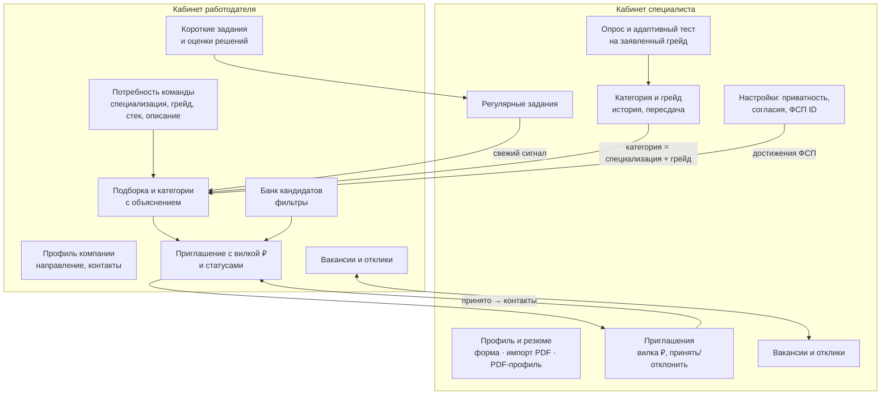
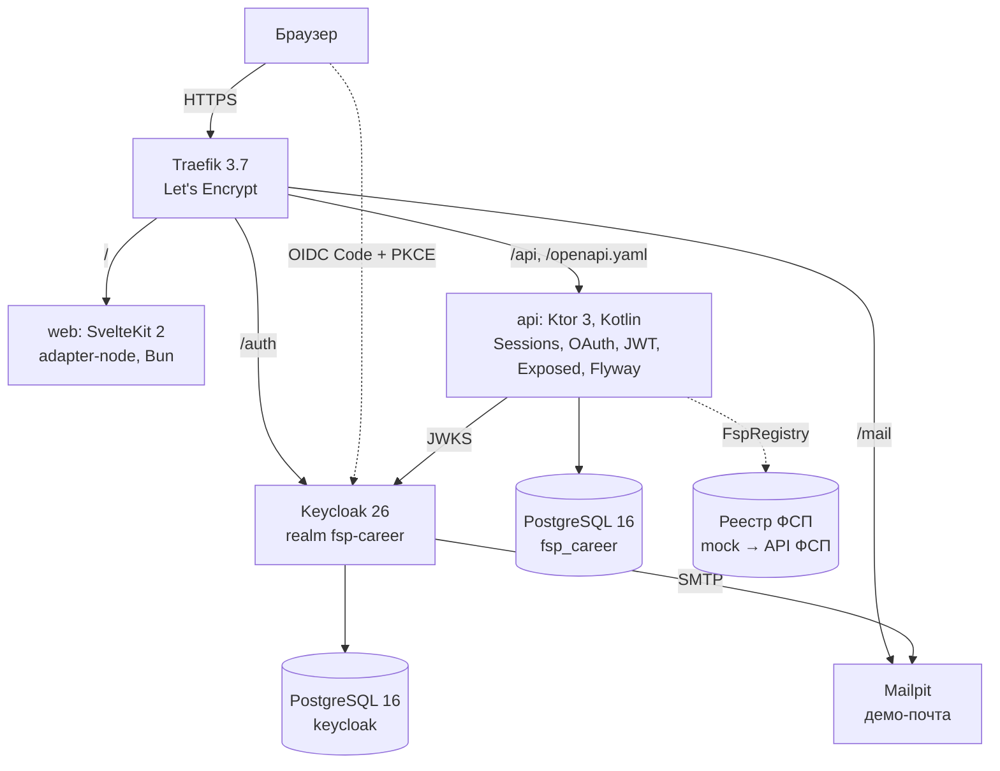

# Архитектура решения {#architecture}

## Функциональная архитектура

**Главный сценарий — обратный подбор.** Специалист не откликается вслепую. Он один раз проходит обязательный путь (опрос → выбор грейда → тест) и получает подтверждённую категорию. Работодатель описывает потребность, получает ранжированную подборку с объяснением и сам отправляет приглашение с описанием и зарплатной вилкой. Контакты специалиста открываются только после того, как он примет приглашение. Классический сценарий (вакансия и отклик) реализован как дополнительный.

## Компонентная архитектура

| Слой | Компонент | Ответственность |
|---|---|---|
| Frontend | `apps/web` (SvelteKit, TypeScript, CSS) | Лендинг, отдельный экран `/login` и два кабинета. Собственные формы входа/регистрации, кнопки ФСП ID и VK ID; API вызывается с HttpOnly cookie и CSRF-токеном. |
| Backend | `apps/api` (Ktor, DDD-модульный монолит) | Доменные правила, прикладные сценарии, адаптеры БД/интеграций и HTTP-маршруты разделены по контекстам. |
| Хранение | PostgreSQL 16 | Реляционная схема под управлением Flyway (`db/migration`), JSONB для списков (стек, навыки). |
| Идентификация | Собственная авторизация + Keycloak 26 / VK ID | Ktor Sessions/OAuth/JWT; Keycloak временно выступает как провайдер ФСП ID. |
| Инфраструктура | Docker Compose, Traefik, GitHub Actions | Воспроизводимый запуск, HTTPS, автодеплой. |

Frontend `apps/web/src/lib` организован по FSD: `shared` (HTTP-клиент, single-flight чтение cookie-сессии, общие UI и светлая семантическая тема), `entities` (DTO и API аккаунта, специалиста, компании, оценки, приглашений, вакансий и заданий), `features` (формы и действия по сценариям), `widgets` (навигация и обзор), `pages` (лендинг, авторизация и оркестрация кабинета). Файлы в `routes` подключают страницы. Внешний код импортирует срезы через `index.ts`; детали среза используют относительные импорты. Ошибки загрузки данных не маскируются под ошибки входа.

## Модули API

Монолит организован по ограниченным контекстам DDD. Внутри каждого находятся `domain` (модели, инварианты, политики и порты репозиториев), `application` (сценарии и порты чтения/документов), `infrastructure` (Exposed DAO, реализации репозиториев, PDF, криптография, реестры) и `http` (Ktor). Прикладные сервисы зависят от портов, а не от конкретных адаптеров; доменный код не зависит от внешних слоёв. В сервисах нет HTTP, SQL и PDF-операций, а HTTP-обработчики не выполняют SQL. Эти границы проверяет `ArchitectureTest`.

`Dependencies.kt` объединяет модули регистрации Ktor DI: `PlatformDependencies.kt` содержит ленивые фабрики общей БД, конфигурации авторизации и HTTP-клиента, а каждый контекст регистрирует свои репозитории, адаптеры и сервисы в корневом файле `*Dependencies.kt`. Все модули используют один контейнер уровня приложения: он создаёт по одному экземпляру зависимости и закрывает пул БД и клиент при остановке приложения. Модули и маршруты получают зависимости через `application.dependencies`; тесты подменяют провайдеры в контейнере. Exposed DAO-сущности с UUID, строковыми, числовыми и составными ключами существуют только внутри транзакций инфраструктуры; наружу возвращаются доменные значения. Каждый метод репозитория атомарно выполняет проверки владельца и операции с данными. SQL DSL используется для пакетных проекций чтения, агрегаций и массового удаления данных при отзыве согласия; Flyway управляет схемой БД.

| Контекст | Пакет | Что делает |
|---|---|---|
| Идентичность | `identity` | Локальные credentials, OAuth, сессии, одноразовый выбор роли и проверка владения аккаунтом. |
| Профили | `profiles` | Профили специалиста/компании, потребности, согласия, приватность, PDF-черновик и экспорт резюме. |
| Оценка навыков | `assessment` | Справочники, семейства заданий, IRT/CAT, подтверждение грейда и правила пересдачи. |
| Подбор | `matching` | Признаки, ранжирование, объяснения, рекомендуемые категории, банк кандидатов. |
| Достижения | `achievements` | Порт `FspRegistry`, адаптер `MockFspRegistry`, проверка владения ФСП ID и импорт результатов. |
| Найм | `recruitment` | Приглашения, вакансии, отклики, раскрытие контактов, еженедельные задания и оценки решений. |

`shared/domain` содержит общий словарь грейдов и доменные ошибки, `shared/http` — преобразование ошибок в прежние HTTP-коды/JSON, `shared/infrastructure` — подключение БД и демо-адаптер. `Application.kt` остаётся точкой сборки приложения. Контексты используют общую PostgreSQL-БД: межконтекстные проверки, блокировки строк и удаление данных при отзыве согласия выполняются атомарно. Маршруты API, схема БД и CLI-точки входа сохранены.

## Данные

Основные сущности: `accounts` (subject Keycloak → роль); `candidate_profiles` (профиль, согласия, приватность, ФСП ID); `employer_companies` и `employer_needs`; `assessment_attempts` (опрос, заявленный грейд, θ, результат, подтверждённый грейд) и ответы; `achievements` (подтверждённые достижения ФСП); `invitations` (описание, вилка ₽, способ связи, статус); `vacancies`, `vacancy_applications`; `short_tasks`, `short_task_submissions`, `short_task_offers`. Ограничения целостности (CHECK, UNIQUE, FK с каскадом) закреплены в миграциях: например, вилка зарплаты `min > 0` и `max ≥ min`, а статусы перечислены явно.
