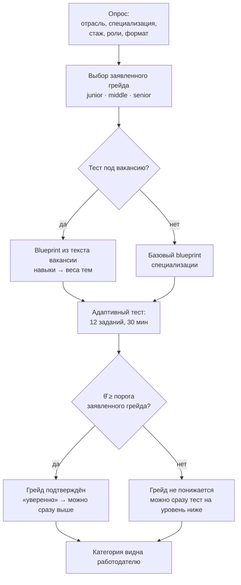

# Механика тестирования {#assessment}

## Путь кандидата

## Почему так: две проблемы из ТЗ

| Проблема | Решение |
|---|---|
| Единый набор заданий быстро утекает | Банк из **семейств заданий**. Семейство — это один навык на одной откалиброванной сложности. 59 из 76 семейств — **параметрические генераторы**: каждый кандидат получает свой экземпляр (новые числа, таблица, фрагмент кода), а сервер пересчитывает правильный ответ из seed и хранит его только у себя. Остальные 17 — наборы изоморфных вариантов. Выученный ответ чужого экземпляра бесполезен. |
| Генерация нейросетью не гарантирует сопоставимую сложность | Все экземпляры семейства имеют **одинаковые параметры IRT** (2PL: дискриминативность *a*, трудность *b*, у заданий с выбором — асимптота угадывания *c* = 1/число вариантов). Поэтому формы сопоставимы, а оценка объективна: это шкала способности θ, а не доля верных ответов на случайный набор. |

## Банк заданий

76 семейств: backend 26, frontend 28, данные 27, продукт 15, дизайн 19 (в каждую специализацию входят 11 общих семейств CS). Примеры генераторов: вывод фрагмента кода на Kotlin, Python или JS со случайными значениями; сложность сгенерированного цикла; результат SQL-запроса по сгенерированной таблице; HTTP-статус для сценария; уровень изоляции транзакций; специфичность CSS; порядок event loop; рендер и эффекты React; статистика (медиана, перцентиль, конверсия, значимость); продуктовые метрики (retention, ARPU, воронка); контраст и доступность. Задания на русском. Ключи ответов никогда не отдаются клиенту, а корректность во время теста не раскрывается.

## Адаптивный тест (CAT)

- **Старт** в якоре заявленного грейда на шкале θ: junior −1.0, middle 0.15, senior 1.4.
- **Выбор следующего задания**: максимум информации Фишера при текущей оценке θ в пределах квот тем из blueprint. Среди почти равных кандидатов (≥ 85% информации лучшего) берётся наименее показанное семейство — это контроль экспозиции.
- **Оценка**: EAP с популяционным априорным N(0, 1). Заявленный грейд влияет только на маршрут теста, но не на итоговую оценку. Балл 0–100 = 100·Φ(θ̂).
- **Пороги грейдов**: middle ≥ −0.5, senior ≥ 0.8 (примерно 31 и 79 баллов). Заявленный грейд подтверждён, если θ̂ − k·SE ≥ порога. k = 0 выбран по минимуму потерь в валидационном переборе: завышение весит вдвое больше занижения. «Уверенно» означает, что θ̂ выше порога следующего грейда.
- 12 заданий, 30 минут, одна открытая попытка. Брошенная или просроченная попытка засчитывается как неудачная, а неотвеченные задания считаются неверными.

## Правила грейда и пересдачи

- **Грейд не понижается**: подтверждённый грейд = max(прежний, заявленный при успехе). Первая неудача даёт junior как начальный уровень.
- **Повтор** на тот же или более высокий уровень — не раньше чем через **90 дней** (по специализации).
- **Сразу можно**: после неудачи — один тест на уровень ниже; после уверенного успеха — один тест на уровень выше, если этот уровень не был провален в окне 90 дней.
- Нарушение правил возвращает `409` с причиной и датой `retakeAvailableAt`. Интерфейс показывает, какие грейды доступны сейчас.

## Задания из описания вакансии

Функция `blueprintFor(специализация, текст вакансии)` выделяет навыки из текста по русско-английскому словарю с синонимами и лёгким стеммингом. Найденные навыки превращаются в веса тем: 60% от вакансии, 40% — ядро специализации. Веса дают квоты заданий. В приложении есть раздел «Как формируются задания»: демо-вакансия → найденные навыки → план тем → пример сгенерированных заданий (без ответов). Есть пять демо-вакансий: Kotlin-бэкенд в финтехе, React/TS-маркетплейс, аналитик в EdTech, PM подписочного сервиса, дизайнер банка. Кандидат может пройти тест «под вакансию».

## История и связь с подбором

История хранит опрос, заявленный грейд, вакансию, θ ± SE, число верных ответов, итог и грейд до и после. Темы, подтверждённые в тестах (не меньше двух верных ответов и не меньше 2/3 верных по теме), передаются в подбор как **подтверждённые навыки**: в факторе стека они весят 1.0, а навык, только заявленный в профиле, — до 0.5.

## Регулярные короткие задания

Раз в неделю система предлагает кандидату задание от работодателя его специализации и грейда. Выбор детерминированный: SHA-256 от «кандидат | неделя» по модулю пула. Поэтому в одну неделю у разных кандидатов разные задания. Ответить можно решением или описанием подхода. Работодатель видит ответы (категорию, но не контакты) и ставит оценку 1–5. Ответ обновляет активность кандидата, а она учитывается в факторе актуальности ранжирования.
