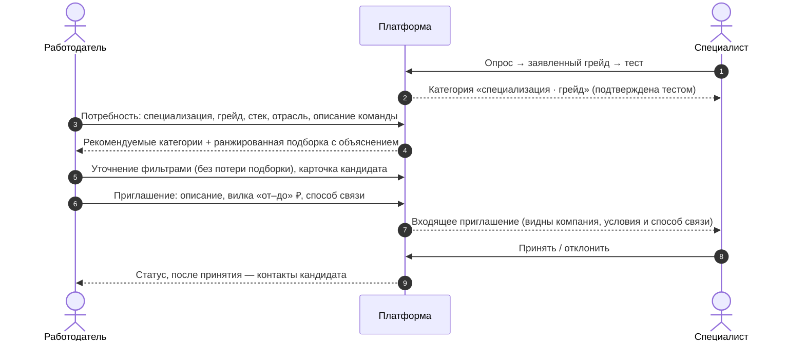

# Механика подбора и категоризация {#matching}

## Сценарий выхода на контакт

Инициативу проявляет работодатель, как в модели LHH: он не разбирает поток откликов, а работает с уже категоризированной базой.

**Чем это отличается от обычных площадок.**

1. Выдача строится по категории, подтверждённой тестом, а не по самоописанию.
2. Кандидат видит условия, включая зарплатную вилку, до начала общения.
3. Контакты защищены до явного согласия кандидата.
4. Каждая позиция в выдаче объяснена.

## Категоризация

**Категория** — это пара «специализация · подтверждённый грейд», например «Backend-разработка · Middle». Справочник специализаций: backend, frontend, данные и аналитика, продукт, дизайн. Грейды: junior, middle, senior. Категория появляется только после теста. Заявленный грейд, грейд в резюме и список навыков не могут ни создать категорию, ни повысить её. Учитывается лучший результат в текущей специализации.

## Два режима выдачи

| Режим | Где | Порядок |
|---|---|---|
| **Подборка под потребность** | «Подбор», `GET /api/matches` | Релевантность потребности работодателя (формула ниже) |
| **Банк кандидатов / категория** | «Банк», `GET /api/bank/candidates` | Сила подтверждённого профиля: `65·тест + 25·ФСП + 10·актуальность` |

Рекомендуемые категории — это категории с количеством подходящих кандидатов и их средней силой профиля. Клик по категории открывает её в банке. Фильтры: специализация, грейд, категория, стек (все указанные навыки, с учётом синонимов), наличие достижений ФСП, отрасль, свободный текст. Фильтры уточняют уже полученную выборку на клиенте, и она не теряется. Переключение между режимами сохраняет обе выборки.

## Формула релевантности

Это чистая функция `matching/MatchingEngine.kt`, формула описана в комментарии к ней.

1. **Фильтр по категории.** Проходят только опубликованные кандидаты (дано согласие на обработку и на публикацию) с подтверждённой специализацией, совпадающей с нужной. Множитель за грейд: точное совпадение ×1.00, на ступень выше ×0.85, на две ×0.70. Грейд ниже требуемого исключается; его можно включить флагом `allowLowerGrade`, тогда множитель ×0.60.
2. **Релевантность** = множитель грейда × сумма факторов (из 100):

| Фактор | Вес | Как считается |
|---|---|---|
| Тест | 30 | нормированный балл теста (0–100) |
| Текст | 25 | TF-IDF-косинус между описанием потребности (плюс стек ×2) и описанием опыта кандидата, насыщение при 0.35 |
| Стек | 20 | по каждому требуемому навыку: подтверждён тестом 1.0; указан и описан в опыте 0.8; только описан 0.5; только указан 0.5 × r, где r = (подкреплённые + 1)/(указанные + 2) — достоверность всего заявленного списка |
| ФСП | 15 | сумма баллов подтверждённых достижений с учётом давности (1.0 первые два года, затем −0.2 в год, минимум 0.4) / 20, не больше 1 |
| Отрасль | 5 | совпадает — 1.0, упомянута в опыте — 0.5 |
| Актуальность | 5 | 1.0, если активность была не раньше 30 дней назад, линейно до 0.3 к году. Активность — это обновление профиля, тест, привязка ФСП или ответ на регулярное задание |

Если в потребности нет стека или отрасли, соответствующий фактор исключается, а остальные масштабируются до 100. При равенстве порядок определяется силой профиля, затем ID кандидата, поэтому он детерминирован.

**NLP.** Текст токенизируется (русский и английский), русские слова приводятся к основе стеммером Snowball, а ИТ-термины канонизируются: «постгрес», «PostgreSQL» и «postgres» считаются одним термином. Каждый документ векторизуется TF-IDF по всему пулу. Теги стека не входят в текстовый документ, чтобы не учитываться дважды. Благодаря этому «накрутка» стека тегами без подкрепления опытом почти ничего не даёт.

**Баллы ФСП** вычисляются по версионируемой политике: база по уровню (международный 10, всероссийский 7, региональный 4) × исход (победитель 1.6, призёр 1.3, финалист 1.0, участник 0.5), от 1 до 20 за результат. **Кандидат без истории ФСП** получает за этот фактор 0, и больше ничего не меняется (это закреплено юнит-тестом). В объяснении выводится строка «История ФСП не привязана — фактор не начислен (это не штраф)».

## Объяснимость

У каждой позиции есть `factors[]`: вклад фактора в баллах и русская формулировка. Например: «Тест: 82/100, подтверждённый грейд middle», «Стек: 3 из 4 — Kotlin, PostgreSQL, Docker; нет: Kafka», «Достижения ФСП: призёр финала…», «Отрасль совпадает: финтех». Кроме того, есть флаги («Грейд выше требуемого», «Нет истории ФСП», «Профиль давно не обновлялся») и краткое резюме. В интерфейсе факторы показаны полосками, а карточка кандидата объясняет, почему он попал в подборку.

## Приватность в выдаче

Кандидат выбирает, что видно работодателю: ФИО (иначе «Кандидат №…»), стек, опыт, историю работы, гибкие навыки, достижения ФСП. Скрытые разделы не возвращаются API и **не используются в ранжировании**. E-mail и телефон никогда не попадают в выдачу. Они раскрываются в карточке и в приглашениях, только если кандидат принял приглашение этого работодателя или сам откликнулся на его вакансию. Это правило реализовано в одной функции `disclosedCandidates()`.

## Дополнительный сценарий: вакансии и отклики

Работодатель публикует вакансии (вилка ₽ обязательна, формат работы, город), редактирует и закрывает их и работает с откликами со статусами «отправлен → просмотрен → принят / отклонён». Кандидат видит ленту вакансий, где сначала идут подходящие его категории, с объяснением совпадения. Откликнуться можно, только если подтверждена категория: работодатель должен видеть результат теста. Отклик сразу раскрывает контакты этому работодателю, а его отзыв удаляет раскрытие.
