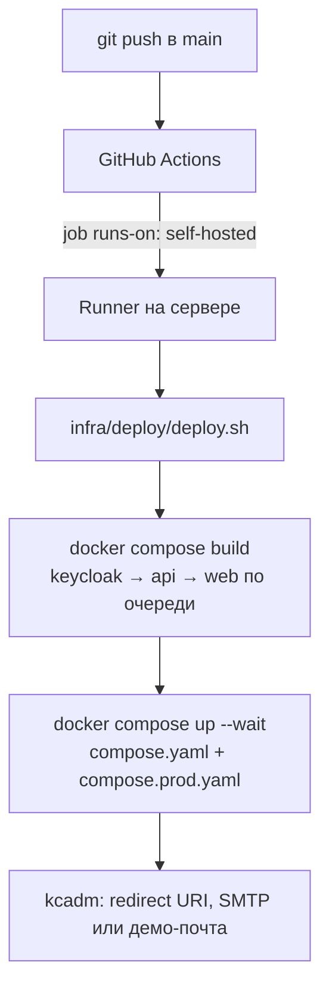

# Сборка, развёртывание и локальный запуск {#deploy}

## Развёрнутый прототип

- Платформа: <https://brokenbrain.online>. Регистрация открыта; роль (специалист или работодатель) выбирается при первом входе.
- Письма подтверждения: демо-почта <https://brokenbrain.online/mail/>, если на сервере не настроен SMTP.
- Демо-аккаунты и тестовые данные описаны в разделе «Демонстрация» (см. «Обзор решения»).
- OpenAPI: <https://brokenbrain.online/openapi.yaml>.

## Локальный запуск (Docker)

Нужны только Docker Engine и Compose v2.

```sh
git clone https://github.com/06ED/fsp-career && cd fsp-career
cp .env.example .env          # при необходимости поменяйте пароли
docker compose up --build -d  # web, api, PostgreSQL ×2, Keycloak, Mailpit
docker compose ps             # дождитесь статуса healthy (Keycloak стартует ~1 мин)
```

| Сервис | Адрес |
|---|---|
| Платформа | <http://localhost:3000> |
| API и OpenAPI | <http://localhost:8080>, <http://localhost:8080/openapi.yaml> |
| Keycloak (админка) | <http://localhost:8081/admin/> (логин и пароль из `.env`) |
| Почта (Mailpit) | <http://localhost:8025> |

Сценарий: «Создать аккаунт» → подтвердить e-mail через ссылку в Mailpit → выбрать роль. Для работодателя удобно использовать второй аккаунт в окне инкогнито. Демо-данные загружаются скриптом `python3 docs/seed_demo.py` (см. README).

Порты публикуются только на `127.0.0.1`. Команда `docker compose down` сохраняет базы данных, `docker compose down -v` удаляет их без возможности восстановления.

## Сборка без Docker (разработка)

- API: JDK 21 и Gradle 9: `cd apps/api && gradle test installDist`. Запуск: `gradle run` с переменными `DATABASE_URL`, `DATABASE_USER`, `DATABASE_PASSWORD`, `KEYCLOAK_ISSUER`, `KEYCLOAK_AUDIENCE`.
- Web: Bun 1.4: `cd apps/web && bun install --frozen-lockfile && bun run dev` → <http://localhost:5173>. Проверки: `bun test` (регрессия авторизации в `apps/web/test/auth.test.ts`), `bun run check`, сборка: `bun run build`.
- Валидация механик (синтетический прогон): `cd apps/api && gradle validateAssessment validateMatching` пишет отчёты в `docs/validation/`.

## Промышленное развёртывание (как устроено на brokenbrain.online)



1. GitHub Actions (`.github/workflows/deploy.yml`) при каждом push в `main` запускает задание на self-hosted runner, установленном на сервере. Задания не пересекаются: работает `concurrency`.
2. `infra/deploy/deploy.sh` при первом запуске генерирует секреты в `~/.config/fsp-career/.env`, вне репозитория. Затем по очереди собирает образы (на 4 ГБ RAM это важно): если сборка упала, работающая версия остаётся нетронутой. После этого поднимает стек с проверкой healthcheck.
3. `compose.prod.yaml` переводит Keycloak в production-режим за прокси (`/auth`), ограничивает heap JVM, публикует наружу только Traefik (80/443, Let's Encrypt) и задаёт маршруты: `/` — web, `/api` и `/openapi.yaml` — API, `/auth` — Keycloak, `/mail` — демо-почта.
4. Почта: если в env-файле есть `SMTP_HOST`, `SMTP_PORT`, `SMTP_USER`, `SMTP_PASSWORD`, `SMTP_FROM`, скрипт настраивает их в Keycloak. Иначе письма идут в демо-почту, а сброс пароля отключён.

Требования к серверу: 2 vCPU, 4 ГБ RAM, swap 2 ГБ, 20 ГБ диска, Ubuntu 24.04 с Docker. Под нагрузкой в покое стек занимает около 1.5 ГБ RAM.
