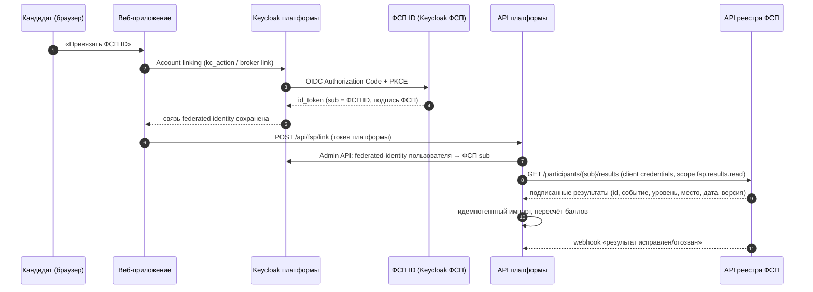

# Интеграция с реестром ФСП {#fsp}

**Цель.** Профиль кандидата получает достижения из реестра ФСП автоматически и только из доверенного источника. Набранный вручную номер участника ничего не доказывает, поэтому привязка всегда подтверждается владением учётной записью.

**Как сделано в прототипе.** Интеграция спрятана за интерфейсом `FspRegistry`. Реализация `MockFspRegistry` читает синтетический реестр (таблицы с участниками и результатами), который заполняется миграцией. Владение проверяется сравнением: e-mail участника в реестре должен совпасть с подтверждённым e-mail пользователя в Keycloak. После привязки результаты импортируются как подтверждённые достижения: событие, дисциплина, дата, место или роль, уровень. Баллы для ранжирования считаются по явной версионируемой политике. Отвязка удаляет импортированные записи и пересчитывает выдачу. Кандидат без истории ФСП проходит весь путь без штрафа: бонуса за достижения у него нет, а в объяснении выдачи стоит строка «История ФСП не привязана».

**Целевая схема с ФСП ID на Keycloak.**

- **Идентичность.** ФСП ID подключается к Keycloak платформы как Identity Provider (OIDC brokering). Привязка — стандартный account linking: пользователь входит в ФСП ID, и Keycloak сохраняет связь `federated identity`. Подменить чужой ФСП ID нельзя, потому что субъект берётся из подписанного `id_token` ФСП.
- **Данные.** Коннектор работает от сервисной учётной записи (client credentials) и запрашивает только результаты привязанного участника. Хранятся внешний ID результата, тип (участие, призёр, победитель), уровень соревнования, дата, источник и версия политики, статус `verified/revoked` и время последней сверки. Ключ уникальности — `(source, external_id, candidate_id)`, поэтому повторный импорт ничего не дублирует.
- **Актуальность.** Webhook реестра или периодическая сверка отзывают и исправляют результаты, после чего выдача пересчитывается. Отзыв согласия кандидатом удаляет импортированные данные.
- **Что увидит работодатель.** Только то, что кандидат разрешил в настройках приватности: название события, уровень, место и дату, без внутренних идентификаторов ФСП.
- **Что нужно от ФСП.** Регистрация клиента OIDC в ФСП ID, контракт API результатов (поля, коды уровней, правила отзыва), тестовый стенд с тестовыми участниками и соглашение об обработке персональных данных.

# Безопасность и 152-ФЗ {#security}

- **Аутентификация** через Keycloak 26: регистрация по e-mail с обязательным подтверждением адреса, защита от перебора паролей, пароли хранятся только в Keycloak в виде хешей Argon2. Браузер использует публичный клиент с Authorization Code + PKCE, без client secret. API проверяет подпись JWT по JWKS, а также `iss`, `aud=fsp-api` и срок действия.
- **Разграничение прав.** Роль (специалист или работодатель) выбирается один раз и хранится в БД. Каждый маршрут API проверяет роль и владение записью на сервере. Кандидат видит только свои приглашения и отклики. Работодатель не получает e-mail и телефон кандидата, пока кандидат не принял приглашение или сам не откликнулся на вакансию.
- **Согласия.** Согласие на обработку данных и согласие на публикацию профиля в подборках даются раздельно. Отзыв согласия удаляет профиль, ответы на тесты, черновики резюме, достижения и приглашения кандидата. Настройки приватности определяют, какие разделы профиля видит работодатель.
- **Минимизация.** Контакты не попадают в списки и объяснения выдачи. Ключи ответов на тесты хранятся только на сервере. В логах нет токенов и персональных данных.
- **Транспорт и инфраструктура.** Наружу открыт только Traefik: HTTPS с сертификатом Let's Encrypt и редирект с HTTP. Базы данных и Mailpit доступны только внутри сети Docker. Секреты генерируются при первом развёртывании и лежат только на сервере, вне репозитория.
- **Для промышленной эксплуатации** нужны: хранение данных на территории РФ, назначенный ответственный за обработку ПДн, уведомление Роскомнадзора, журналы доступа, резервное копирование с шифрованием и регламент удаления по запросу субъекта.

# Защита от фиктивных вакансий и недобросовестных работодателей (концепция) {#antifraud}

В MVP не реализуется (так оговорено в ТЗ). Архитектура к этому готова: роль работодателя и все его действия (вакансии, приглашения, задания) уже привязаны к одной учётной записи компании.

| Уровень | Механизм |
|---|---|
| Верификация компании | Проверка ИНН и ОГРН по ЕГРЮЛ (API ФНС или DaData), подтверждение домена (e-mail на корпоративном домене или DNS TXT-запись), подтверждение представителя через Госуслуги (ЕСИА) для расширенного статуса. Бейдж «Компания проверена» виден кандидату в приглашении. |
| Лимиты до верификации | Ограничение числа приглашений и вакансий в сутки и запрет массовых одинаковых приглашений. Вилка зарплаты обязательна и проверяется на правдоподобие по рынку для специализации и грейда; аномалии (например, junior за 1 млн ₽) уходят на модерацию. |
| Сигналы риска | Скоринг работодателя: доля отклонённых приглашений, жалобы кандидатов, приглашения без последующего общения, повторяющиеся тексты, подозрительные домены и контакты (мессенджеры вместо корпоративной почты), запрос оплаты или персональных данных сверх необходимого. |
| Обратная связь | Кнопка «Пожаловаться» в приглашении и вакансии. Несколько независимых жалоб автоматически скрывают вакансию до модерации. Рейтинг работодателя строится по подтверждённым взаимодействиям. |
| Защита кандидата | Контакты кандидата раскрываются только после его согласия: принятое приглашение или собственный отклик. Работодатель с низким рейтингом не видит кандидатов, у которых включён фильтр «только проверенные компании». |
| Модерация | Очередь модерации с правилами и ручной проверкой. Логи всех действий работодателя хранятся для разбора инцидентов. |

# Интеграция с ATS работодателей (концепция) {#ats}

Цель — чтобы рекрутер работал в своей ATS (Huntflow, Potok, E-Staff, Talantix, SAP SuccessFactors и др.), а платформа поставляла в неё подтверждённых кандидатов.

- **Исходящие события (webhooks).** `invitation.accepted`, `application.created`, `application.status_changed`, `task.submitted`. Каждое событие подписано HMAC-SHA256, отправляется повторно с экспоненциальной задержкой и несёт ключ идемпотентности. Состав данных — только то, на что кандидат дал согласие.
- **API для ATS.** Сервисные ключи работодателя (OAuth2 client credentials) со scope `candidates.read`, `invitations.write`, `vacancies.write`. Через них можно выгрузить карточку кандидата (категория, результаты тестов, достижения ФСП, PDF-профиль) и синхронизировать вакансии и статусы в обе стороны.
- **Формат.** JSON по OpenAPI-схеме платформы с маппингом на модели популярных ATS. Плюс стандартизированный PDF-профиль, который уже генерирует платформа.
- **Коннекторы.** Модуль-адаптер на каждую ATS (маппинг полей и статусов) работает на общей очереди событий. Первым делом — Huntflow и Potok, у которых открытые API.
- **Безопасность.** Отзыв ключей, журнал выгрузок и отзыв согласия кандидатом с отправкой события `candidate.consent_revoked`. По нему ATS обязана удалить данные.
